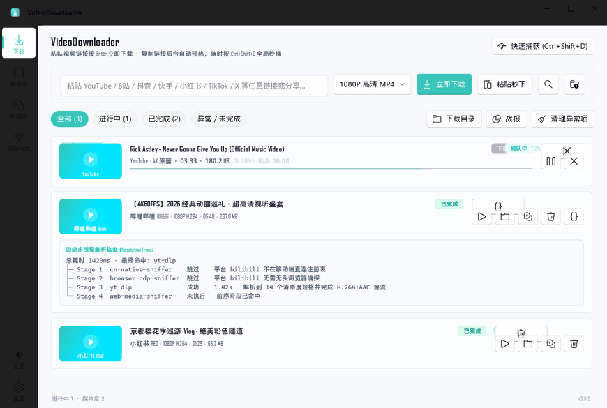
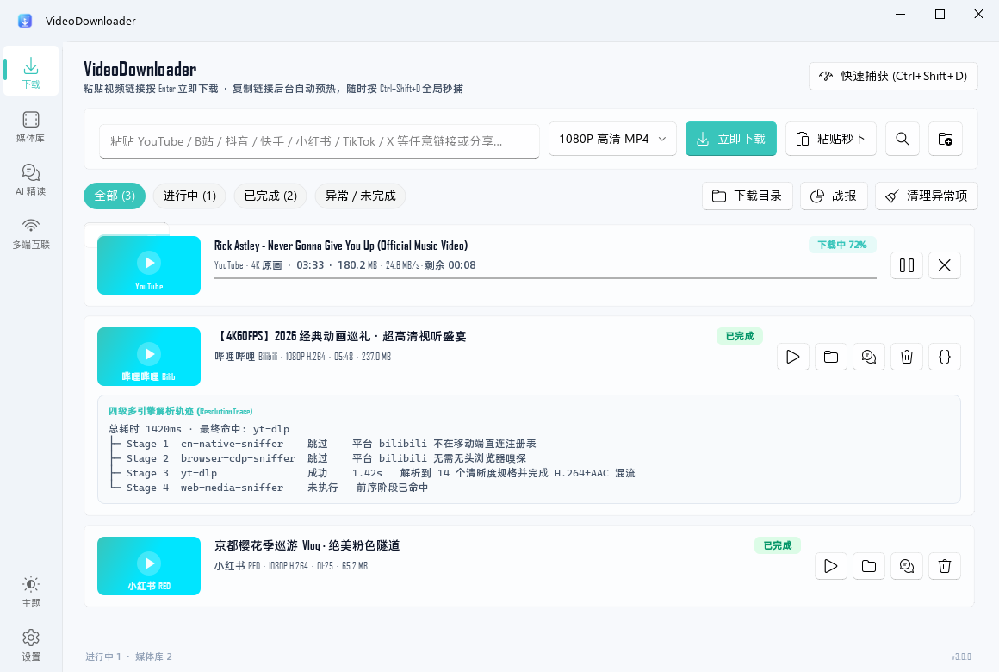
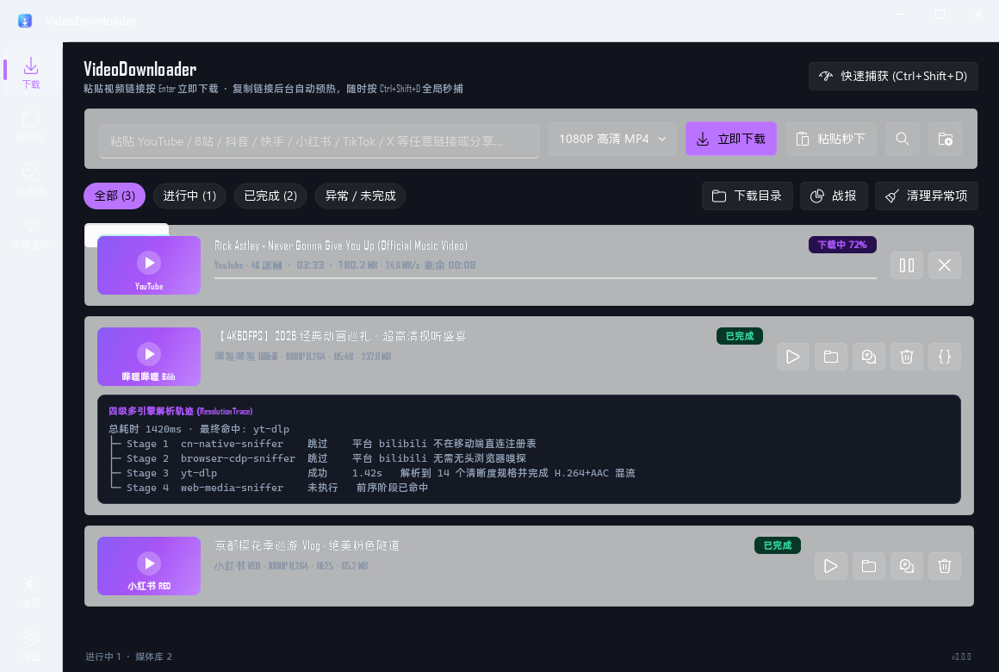
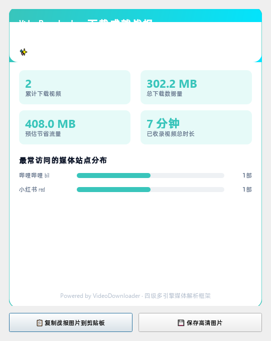

<div align="center">


# VideoDownloader 全网多平台视频下载器 & AI 智能分镜工作台

**⚡ 专注于 B站 / 抖音 / 小红书 / YouTube / 微博 / 快手全网多引擎极速解析下载 · 影视级 AI 分镜脚本拆解 · 现代二次元 Fluent 桌面客户端**

*A high-performance, explainable multi-engine video downloader for Bilibili, Douyin, Xiaohongshu, YouTube & 100+ platforms with AI storyboard extraction.*

[](https://github.com/huzhenchen66-cloud/VideoDownloader/releases)
[](./LICENSE)
[](https://www.python.org/)
[](#-快速开始)
[](#-软件界面展示)
[](#-工业级自动化测试)

[📥 立即下载 Windows 安装包](https://github.com/huzhenchen66-cloud/VideoDownloader/releases/download/v3.0.0/VideoDownloader-Setup-3.0.0-x64.exe) · [📦 免安装绿色便携版](https://github.com/huzhenchen66-cloud/VideoDownloader/releases/download/v3.0.0/VideoDownloader-3.0.0-Windows-portable.zip) · [📖 使用文档](./docs/advanced.md)

</div>

---

## 🎯 核心平台支持矩阵 (Platform Matrix)

针对主流短视频与视频平台进行了专门的反爬指纹突破、防风控协议适配与自适应降级：

| 平台名称 | 常见搜索场景 | 支持特性与解析能力 | 画质与协议优势 |
| :--- | :--- | :--- | :--- |
| **📺 哔哩哔哩 (Bilibili)** | B站视频下载、番剧提取、B站音频/弹幕下载 | 视频、音频、分P批量、互动视频、大会员高码率、**AI 自动字幕秒级直采** | 4K / 8K / 杜比视界 / 自举 SPI buvid 突破 412 拦截 |
| **🎵 抖音 (Douyin) / 剪映** | 抖音无水印下载、短视频提取、原声下载 | 一键自动去除官方水印、作者主页批量提取、原声 MP3 提取 | 1080P+ / 原画直链，免登录极速解析 |
| **📕 小红书 (Xiaohongshu)** | 小红书视频下载、小红书图文无水印保存 | 笔记无水印视频、实况动图 (LivePhoto)、高清配图批量原图保存 | 移动端原生无水印直链，避开 Web 防盗链 |
| **🔴 YouTube** | YouTube 视频下载、Shorts 下载、4K/8K 视频保存 | 完整视频、Shorts 短片、频道播单、音轨独立分离、外挂多语言字幕 | 4K / 8K 60fps HDR，注入真实浏览器 TLS 指纹 |
| **⚡ 快手 (Kuaishou)** | 快手短视频无水印下载 | 短视频无水印 MP4、快手图集解析 | 原画质免流直链提取 |
| **🌐 全网 100+ 视频流** | 微博、知乎、Twitter/X、网页通用 M3U8/MP4 | 移动端接口 -> 无头 CDP 真实抓包嗅探 -> yt-dlp -> HTML5 保底提取 | 智能四级逐级降级，保障 99.9% 成功率 |

---

## 💡 为什么选择 VideoDownloader？

市面上的下载器大多数是不可解释的黑盒——成功了皆大欢喜，一旦失败只抛出一句冰冷的“解析失败”，既无法排障，也无法应对短视频平台的反爬升级。

**VideoDownloader** 历经架构全面重构，打造了一套**白盒化可解释的多引擎框架 + 影视级 AI 视频分镜工作台 + 现代二次元 Fluent 客户端**：

1. **四级多引擎可观测降级链**：原生短视频逆向直连 ➔ 无头 Chromium CDP 真实抓包 ➔ `yt-dlp` 全球百大平台 ➔ 通用 HTML5/OpenGraph 嗅探。每一步耗时与状态全程可视化输出（`ResolutionTrace`）。
2. **8 线程 Range 并发高速下载**：HTTP 分块并行拉取大文件，搭配 EMA 指数平滑测速，彻底突破单连接限速瓶颈。
3. **AI 影视级分镜工作台**：
   - **6 轨自适应字幕管线**：彻底解决短视频无 CC 字幕痛点，独家支持 B站官方 AI 字幕秒级直采并自动落盘伴随 `.srt`；
   - **影视级分镜脚本拆解**：智能提取景别（特写/近景/中景/全景）、运镜（推/拉/摇/移/固定）、画面细节构图、口播旁白与 BGM 节奏；
   - **纯净文案提炼与金句归纳**：去除口癖语气词，整理三段式纯净逐字稿，提取高价值爆款金句；
   - **主流大模型生态全兼容**：原生支持阿里云百炼 (DeepSeek / 通义千问)、Anthropic Claude、OpenAI、本地免 Key 离线 Ollama 及任意第三方兼容端点。
4. **二次元视觉工程与零版权风险**：
   - 5 套程序化矢量柔光背景（初音绿、樱花粉、星空紫、元气橙、琉璃蓝），基于 `QPainter` 动态呼吸渐变，完全不内置商业受限立绘，零 DMCA 版权风险；
   - 44.1kHz 正弦波程序化自合成专属下载提示音效；
   - `Ctrl+Shift+K` 命令面板与成就战报海报生成。
5. **系统健康体检与纯净设计**：重构设置中心，以温和纯净的中文运行徽标展示模块状态，拒绝生硬代号与杂乱参数。

---

## 🎬 软件界面展示

<div align="center">



<p align="center"><em>工作流演示：复制链接 ➔ 全局热键 0ms 快速捕获 ➔ 回车秒下 ➔ 可视化四级解析轨迹</em></p>

| 🌸 浅色模式（初音极光青） | 💜 深色模式（星空霓虹紫） |
| :---: | :---: |
|  |  |

| ⚡ Raycast 式 0ms Quick Capture 浮层 | 📊 个人成就与战报海报 (Ctrl+K) |
| :---: | :---: |
|  |  |

</div>

---

## 🏗️ 四级引擎降级链路架构

```text
用户输入 / 剪贴板链接
  │
  ├─ Stage 1: cn-native-sniffer    [原生短视频]   抖音 / 小红书 / 快手去水印直链、B站 SPI buvid3 自举
  │     └─ 触发风控 / 失败 ──┐
  │                           ▼
  ├─ Stage 2: browser-cdp-sniffer [无头浏览器]   快手、网页流媒体；无头 Chrome/Edge CDP 抓包捕获真实媒体流
  │     └─ 未捕获媒体流 ─────┐
  │                           ▼
  ├─ Stage 3: yt-dlp              [全球百大核心] YouTube (4K/8K)、B站等 1800+ 站点，注入 curl_cffi 浏览器指纹
  │     └─ 不受支持 ─────────┐
  │                           ▼
  └─ Stage 4: web-media-sniffer   [通用 HTML5]   兜底抓取 <video src> / OpenGraph 标签与媒体头校验
```

支持通过 CLI 命令行实时诊断任意音视频链接：
```powershell
VideoDownloader.exe --explain "https://www.bilibili.com/video/BV1nYx86pEeA"
```

---

## 🚀 快速开始

### 方式一：Windows 正式安装包（最推荐 · 免管理员 UAC）
1. 前往 [Releases 发布页面](https://github.com/huzhenchen66-cloud/VideoDownloader/releases) 下载 `VideoDownloader-Setup-3.0.0-x64.exe`；
2. 双击安装（自动装入 `%LOCALAPPDATA%\Programs\VideoDownloader`，冷启动 < 1.5 秒）；
3. 绿色便携用户可直接下载 `VideoDownloader-3.0.0-Windows-portable.zip`，解压后双击 `run_desktop.exe` 即开即用。

### 方式二：源码运行与多平台开发 (Windows / macOS / Linux)

```bash
# 1. 克隆代码仓库
git clone https://github.com/huzhenchen66-cloud/VideoDownloader.git
cd VideoDownloader

# 2. 安装项目依赖
pip install -e ".[dev]"

# 3. 启动 Fluent 桌面客户端
python run_desktop.py

# 4. 可选：启动局域网 Web / iPhone 互联模式
python run_desktop.py --web
```

---

## 🧪 工业级自动化测试

本项目拥有严密的工业级自动化测试体系，覆盖错误状态码、引擎逐级降级、AI 六轨提取、程序化音效与 SQLite Schema 迁移：

```powershell
pytest tests/ -v
# ======================== 57 passed in 4.21s ========================
```

---

## 🤝 致谢与开源社区 (Acknowledgements)

感谢所有为本项目提交代码、测试反馈与架构灵感的贡献者。项目代码贡献者可在仓库右侧边栏 **Contributors** 查看。

致敬优秀的开源基础设施：
- [yt-dlp](https://github.com/yt-dlp/yt-dlp) - 卓越的全球音视频解析基石
- [PyQt-Fluent-Widgets](https://github.com/zhiyiYo/PyQt-Fluent-Widgets) - 现代 Windows 11 Fluent 视觉交互系统
- [FastAPI](https://github.com/fastapi/fastapi) - 高性能异步 Web 核心

欢迎提交 [Issue](https://github.com/huzhenchen66-cloud/VideoDownloader/issues) 和 [Pull Request](https://github.com/huzhenchen66-cloud/VideoDownloader/pulls) 共同完善全网流媒体下载生态！

---

## 📜 开源协议

本项目基于 [MIT License](./LICENSE) 开源协议发布。仅供计算机网络与多媒体工程学术研究，请遵守各平台服务条款并尊重创作者版权。
